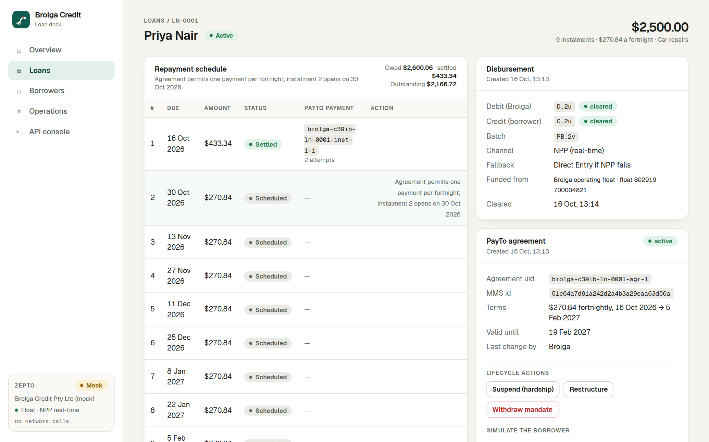
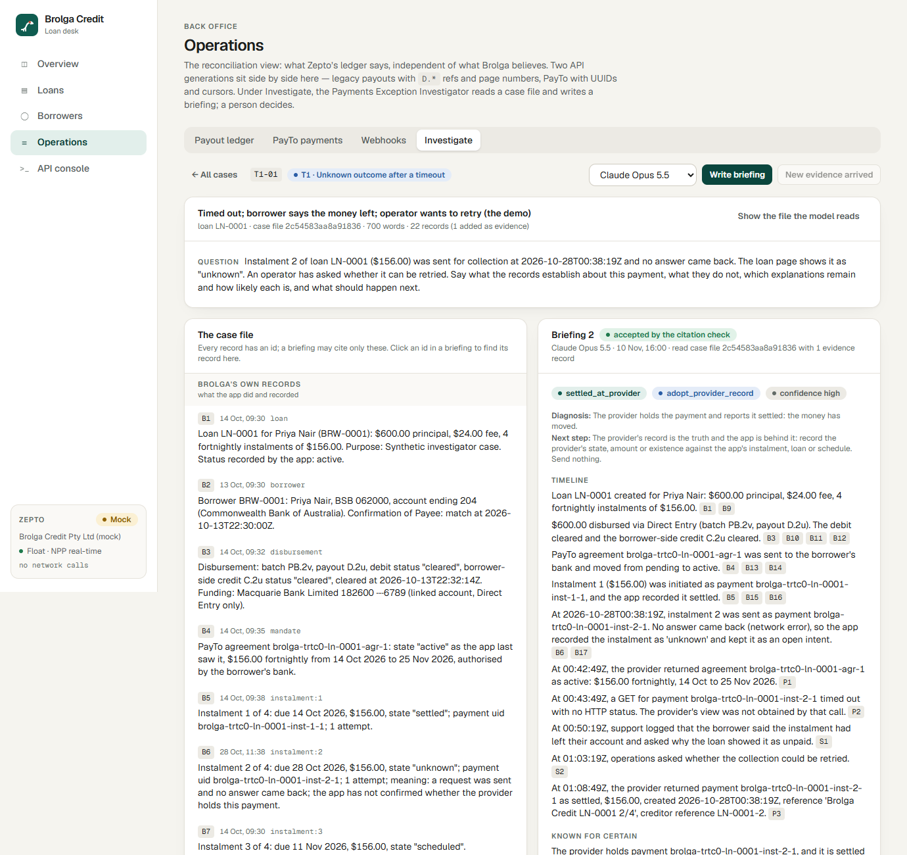

# Brolga Credit — a consumer-lending demo on Zepto

[](https://github.com/mikeohallo/brolga-credit/actions/workflows/ci.yml)
MIT licence.

**For** a loan officer at a small lender who has to move money and know, at every step,
what actually happened. **It does** the loan desk's work against the Zepto payments API:
verify a bank account, pay the loan out, set up a PayTo repayment agreement, collect
instalments, and handle what comes after (missed payments, hardship pauses, restructures,
payoff). Every step is a real API call; nothing is faked when it's pointed at the sandbox.
A demo, not a product.

**Try it in five minutes:** `npm install && npm run build && npm start`, then open
`http://localhost:3000`. With no `.env.local` it runs in mock mode: no token, no network.
`scripts/walkthrough.mjs` drives the whole demo and screenshots each step.

**What's measured:** built and verified end to end against the Zepto sandbox on
12 September 2026 (Direct Entry disbursement, PayTo agreement, real-time collection with
failure and retry, suspension, reactivation, bilateral amendment, cancellation). 73 offline
checks run the real domain code against a mock provider with a controllable clock, on
every push (badge above). Four independent reviews shaped them. The first review's harness
passed 14 of its 36 checks on its first run and became the regression suite. The second and
third found eight more cases it didn't cover, among them two overlapping disbursements
creating two payouts, and a lost payout answer left unreconciled behind a Confirmation of
Payee hold. T46 to T53 reproduce them: each fails on the old code and passes on the fix.

**The Payments Exception Investigator, measured:** an operations tool inside the app (the
Investigate tab) that reads a case file of a payment gone wrong, writes a briefing that
cites the records, and says "insufficient evidence" when that is the answer. On
6 November 2026 its sixty synthetic cases (six kinds of exception, ten of each; twenty
held back by position and never looked at while the prompt was written) were run three
times each on three models, 180 briefings a model, with every rejected briefing counted
as wrong:

| 6 Nov 2026 · prompt v1.1 · all 180 runs a model · held back 60 of them | claude-haiku-5-5 | claude-sonnet-5-5 | claude-opus-5-5 |
|---|---|---|---|
| Diagnosis right: all 180 · held back 60 | 84% (152/180) · 52/60 | 97% (174/180) · 59/60 | **100%** (180/180) · 60/60 |
| Next step right: all 180 · held back 60 | 73% (132/180) · 43/60 | 94% (169/180) · 54/60 | 97% (174/180) · 54/60 |
| Said "insufficient evidence" when it should (39 runs over all sixty: 13 such cases × 3) | 34 | 35 | 39 |
| Claims with no record behind them, or a record not in the file (of every claim in all 180 runs) | 9 of 3,280 | 1 of 2,933 | 0 of 3,360 |
| Briefings rejected by code before anyone saw them (of 180) | 23 | 4 | 0 |
| Cost a briefing (one run; rejected runs included) | $0.0023 | $0.0301 | $0.0669 |

Only the two accuracy rows are split out for the held-back twenty; the other rows are
over all sixty cases, forty of which the prompt was developed against, and only two of the
thirteen "insufficient evidence" cases fell in the held-back set (the split was by
position, and that draw was thin). "Unsupported" here is what code can check: a claim
with no record cited, or citing a record that is not in the file; whether a cited record
actually supports the sentence is the operator's judgement, which the marks record. Code
checks every citation before a briefing is shown, so none of the ten such claims reached an
operator: the briefings carrying them were rejected, and count as wrong above. Every case
file tells the model which kind of exception it is looking at, in its first line, as a
desk's queue would tell an analyst; the diagnosis still has to pick one of three or more
labels within that kind, but the kind itself is given, not found. By the bar the report
sets (no unsupported claims, and "don't know" every time it should) only Opus 5.5 clears it; Sonnet 5.5 is four rejected briefings short, one of them
an overclaim, at less than half the price; Haiku 5.5 misses a sixth of the diagnoses.
Opus's six wrong next steps are two held-back cases, answered the same way three times of
three by Opus and by Sonnet (T5-08: `no_action` where the label says `escalate`; T4-03:
`insufficient_evidence` where the label says `reverify_payee`). The labels stand and the
question is open. An earlier run the same day, with the harness capping answers at 4,000
tokens, cut off 44 of Haiku's answers and 4 of Opus's; it is kept, and the table is the run
after the cap was raised. Between the two runs one next-step definition was redrawn on a
development case (T5-06), and that moved one held-back case's label with it (T5-02, now
`reverify_payee`, which all three models chose three times of three); the held-back
figures are against the labels as they stand (one next-step label, `wait_for_provider`,
is now the right answer for no case and stays in the list only as a wrong turn). The
whole run cost $17.88. The two briefings
an operator has marked so far were both marked right. `scripts/investigate-eval.mjs`
reproduces the run; the cases, their labels and the held-back split are in the repo, so
any of the sixty can be checked.

**Where the AI is:** in one place, the Investigate tab, where a model reads a case file
and writes a briefing a person acts on. No model runs when money moves. Claude wrote the
code and the tests under a product owner's direction, and sessions with no part in
writing it reviewed it. The hardest findings were about uncertainty: a payment whose
outcome is unknown must never be retried as if it had failed; the investigator exists
to say so, with the records cited.



*The screenshot is the app in `mock` mode with synthetic borrowers, taken by
`scripts/walkthrough.mjs` after the first instalment settled and the remaining debt was
restructured from $433.34 to $270.84 a fortnight. The schedule, the 2c rounding adjustment
and the amount owing reconcile to the cent.*

Brolga Credit is a fictional small-loan lender. This app is its loan desk: a loan
officer verifies a borrower's bank account, disburses the loan, sets up a PayTo
repayment agreement, collects instalments, and handles the things that happen to
loans afterwards — missed payments, hardship pauses, restructures, payoff.

Every one of those steps is a real call to the Zepto API. Nothing is faked when
the app is pointed at the Zepto sandbox; the `mock` mode exists only so the app
can be developed and demonstrated when the sandbox is unreachable.

## Run it

Requirements: Node 22.15 or later (the app runs on 20.9+, but the test runner uses
`module.registerHooks`, which arrived in 22.15). Tested on 22 and 24.

```bash
npm install
cp .env.example .env.local       # Windows: copy .env.example .env.local
                                 # then paste your sandbox token into ZEPTO_TOKEN
npm run build
npm start                        # http://localhost:3000
```

The app has no login of its own: it is a loan desk for one operator on one machine, and
anyone who can reach port 3000 can move money with the configured token. `npm start` and
`npm run dev` therefore bind to 127.0.0.1 only; if you deliberately expose it on a network,
put mock mode in front of an audience you do not control.

`npm run dev` also works and hot-reloads, but `build` + `start` is the mode to
use in front of an audience: no compile-on-first-visit pauses.

Set `ZEPTO_MODE=mock` in `.env.local` to run without any network access. The
mock reproduces the sandbox's state machines (payout clearing, PayTo
authorisation delays, amount-driven failures, agreement rules) closely enough
to rehearse the whole demo offline. Each mode keeps its own store
(`data/brolga.json` for the sandbox, `data/brolga.mock.json` for the mock), so
switching modes shows a different set of loans rather than pretending the
sandbox references can be resumed offline.

### The Investigate tab

Operations has a fourth tab, **Investigate**: the Payments Exception Investigator.
It needs one more command before `npm start`, to make its sixty synthetic cases
(six kinds of thing that go wrong with a payment, ten of each, made by running
the real code against the mock under a fixed clock, so every machine makes the
same files):

```bash
node --disable-warning=ExperimentalWarning scripts/investigate-cases.mjs
```

Pick a case, read the records beside the briefing, click a cited id to see the
record behind it, add the prepared evidence and write again, and mark the
briefing right, wrong or incomplete. Writing a briefing is one model call made by
the server with the key in `.env.local` as `BROLGA_INVESTIGATOR_KEY`; without a
key the tab shows the cases and says so. Twenty of the sixty are held back: the
tab shows them but will not write on them, because they are run only by the eval
script, for the numbers at the top of this file. The model never moves money,
never calls the provider and sees nothing but the case file; code checks every
citation before a briefing is shown, and a person decides.
`BROLGA_INVESTIGATOR_STORE` moves the investigator's file (cases, briefings,
marks) out of `data/` if you want it somewhere that outlives a checkout.



*The demo case (a timed-out payment; the borrower says the money left; the operator wants
to retry), after the provider's answer arrived as new evidence: the case file on the left,
the second briefing on the right. The first briefing, further down the page, refused to call
the outcome known; the second, on the same records plus one, adopts the provider's record
and cites the ids it rests on. Both written by Opus 5.5 and passed by the citation check.
Taken by `scripts/walkthrough.mjs` in `mock` mode, 10 November 2026.*

## The story the demo tells

1. **Verify** — `POST /cop/account/validate` (Confirmation of Payee) checks the
   name on the borrower's account before any money moves.
2. **Disburse** — `POST /payments` sends the principal. From a Zepto Float
   Account it goes over the NPP in seconds with Direct Entry as fallback; from
   a linked bank account it goes by Direct Entry.
3. **Mandate** — `POST /payto/agreements` creates a fixed fortnightly PayTo
   agreement the borrower authorises in their own banking app.
4. **Collect** — each instalment is a `POST /payto/payments` that settles or
   fails in real time with an ISO reason code; failed ones can be retried.
5. **Handle life** — suspension and reactivation for hardship, bilateral
   amendment to restructure the instalment, cancellation on payoff, and
   simulated borrower-initiated actions from the banking-app side.
6. **Reconcile** — the Operations screen reads Zepto's own ledger
   (`GET /transactions`, `GET /payto/payments`) rather than the app's beliefs;
   the API console shows every request with version header, idempotency key,
   request id and latency.

## How it is built

```
src/lib/zepto/      typed client for the subset of Zepto used, plus a mock with the same interface
src/lib/domain/     the lending logic: quotes, schedules, state transitions, polling
src/lib/db.ts       a JSON-file store, one file per mode — one operator, one process, no database
src/app/api/        route handlers the UI calls; the token never reaches the browser
src/app/            the screens (Next.js App Router, client components, Tailwind)
src/lib/investigator/  the Payments Exception Investigator: case files, the briefing shape,
                    the citation check, six case generators, one model call; the key stays server-side
tests/review/       offline invariant suite that drives the domain layer against the mock
scripts/            Playwright walkthrough that screenshots the whole demo; the investigator's
                    cases, demo and evaluation scripts
```

Design choices worth knowing:

- **Money moves only when the ledger says so.** A loan is disbursed when the
  borrower-side credit clears, not when the debit leaves. Nothing is collected
  until then, and nothing is collected on a loan whose disbursement failed.
- **Every outbound money call is written down before it is sent.** The
  disbursement intent (with its idempotency key) and the instalment (with its
  PayTo uid) are persisted first. If the network or a 5xx swallows the answer
  the record is marked `unknown`; the next refresh asks Zepto what happened
  before anything is retried, so a lost response never becomes a second
  payment. For a payout that means reading `GET /payments` for the batch
  carrying the intent's key (nothing is re-sent to find out); for a PayTo
  payment, `GET` by uid.
- **Finding a lost payout comes before any gate.** If the payout exists at
  Zepto the money has moved, and it is adopted whatever Confirmation of Payee
  says now — reconciliation is not a new payment. If Zepto has no record of
  it, the loan shows an explicit *unresolved* state and a replay is treated as
  what it is, a new payment: it goes through the CoP gate like any other, so a
  held payee is never paid blind. The CoP verdict recorded on the payout is the
  one taken immediately before the request left, not the earlier one.
- **A restructure changes the authority, Brolga reconciles the debt.** The
  PayTo amendment changes what may be collected; the remaining balance is
  re-cut locally (settled and in-flight instalments keep their amounts) and
  any rounding is recorded as an adjustment so the schedule always equals the
  obligation.
- **Confirmation of Payee is a gate, checked when money moves.** The borrower's
  latest result governs, not a snapshot taken when the loan was written: a
  no-match or closed account holds the loan whenever it arrives, a borrower who
  was never checked cannot be disbursed, and lifting a hold needs an audited
  override with a reason. If Zepto cannot answer, the loan may still be
  disbursed and the timeline says the check was unavailable, not that it passed.
- **One loan, one money movement at a time.** Disbursement runs under a per-loan
  lock and re-reads the loan inside it, so two overlapping requests produce one
  payout and one refusal. An idempotency key protects a repeated request; it
  cannot protect against two different keys for the same action, which is what
  two concurrent clicks would otherwise mint. The lock does not serialise
  verifications, so the CoP gate is enforced a second time immediately before a
  new payment is committed, with nothing asynchronous in between.

- **Polling, not webhooks.** Webhook endpoints can only be created in Zepto's
  portal and need a public URL. Brolga polls the specific objects it has in
  flight (`GET /payments/{ref}`, `GET /payto/agreements/{uid}`,
  `GET /payto/payments/{uid}`) and applies the same state transitions a webhook
  consumer would. Swapping in webhooks is a transport change, not a logic change.
- **Zepto is the system of record for money.** Brolga stores references
  (`PB.*`, `D.*`, agreement and payment uids) and derives loan status from
  what Zepto reports.
- **Sandbox behaviours are first-class.** Simulation controls (how the borrower
  responds to the mandate, whether a collection settles) are in the UI so the
  failure paths can be shown, not just described.

## Tests

```bash
node --disable-warning=ExperimentalWarning tests/review/review-tests.mjs . tests/review/results.json
```

Sixty-eight checks run the real domain code and route handlers against the mock
provider with a controllable clock and no network: schedule arithmetic, the
credit-is-the-truth disbursement rule, collection gating, lost-response
recovery for both payouts and PayTo payments, restructure reconciliation,
CoP holds and overrides, daily-limit and one-per-period rules, store
resilience, and redaction in the API log. The suite began as an independent
review harness (14 of 36 checks passed on the first cut) and was kept as the
regression gate while the findings were fixed.

A second review on 16 October 2026, by a separate session that had not seen the
code being written, found three things the suite did not cover: two overlapping
disbursement requests created two payouts; a Confirmation of Payee no-match that
arrived after the loan was written did not hold it; and provider error text
reached the API log without redaction. T46 to T48 reproduce each one. They fail
on the code as it was and pass on the fix. The same reviewer's re-check found two
narrower gaps: a no-match arriving while the funding lookup was in flight could
still be followed by a payout, and the contact lookup's query string put the
account number in the logged path. T49 and T50 cover those.

A third assessment, of the public repository on 17 October 2026, found that the
recovery of a lost payout answer sat behind the Confirmation of Payee gate, so a
no-match landing after a lost answer left a possibly-sent payment unreconciled,
and that the CoP verdict recorded was the early one rather than the one in force
at submission. T51 to T53 cover the three cases (lost answer then a hold with the
payout found; lost answer then a hold with nothing found; a match that turns
unavailable before submission). They fail on the code as it was and pass on the
fix. The same workflow now runs on every push to this repository — see the badge
above and `.github/workflows/ci.yml`; it holds no secrets and makes no Zepto calls.

T54 to T68 cover the Payments Exception Investigator: the case file and its ids, the
citation check, the scoring, the six case generators and the sixty-case set (T66 pins
their sixty hashes to `tests/review/investigator-hashes.json`), and the Investigate tab's
routes. They drive the whole pipeline with canned answers and prove the real model path
is blocked offline; the suite never calls a model.

A fourth review, on 6 November 2026 by a session with no part in writing the
investigator, read it before its numbers went at the top of this file. It found that
writing a briefing held the store open across the model call and saved a stale copy back,
so a mark or a record saved in those seconds was silently lost; T67 reproduces that and
passes on the fix. It also made the measurement story above say more than it did at
first: that the held-back set was run twice and why, which numbers are over all sixty
cases and which over the twenty, what "unsupported" means to the code, and that the
case file names the kind of exception. The rest of its findings (a carry that compared
too little, a label check that walked the prototype chain, the expected label reaching the
browser before a mark, held-back cases accepting evidence, "cost per case" that was cost
per briefing) are fixed in the same commit, and the sixty hashes did not move.

`CHROME_PATH=<chromium> node scripts/walkthrough.mjs http://localhost:3000 ./shots`
drives the whole demo in a browser and saves a screenshot of each step, ending with one
investigation in the Investigate tab (two model calls, when the key is configured).

## How this was built

Brolga was built with Claude in September 2026, as a way of learning the Zepto API
properly rather than reading about it. The
product rules are mine: what a loan desk needs to see, that the borrower-side
credit is the truth, that no match means no money, what a restructure does to a
debt, and which failure paths had to be demonstrable rather than described. The
code, the mock and the test harness were written with the model, against the
sandbox, with every call visible in the API console as it went.

Two habits mattered more than any prompt. Every money-moving step was persisted
before it was sent, so a lost answer could be recovered rather than guessed at.
And the code was reviewed by a session that had no part in writing it: the first
review's harness failed 22 of its 36 checks and became the test suite; the second,
a month later, found a race and a gating gap that the first had missed; the third,
the next day, found a lost payout answer stranded behind a Confirmation of Payee hold;
the fourth, on the investigator, found a lost update under a slow model call and four
ways the numbers above needed to say more. All four are in the history.

## Things learned about the Zepto API while building this

- `Zepto-Api-Version: 20260101` is mandatory for this account; without it every
  call is a 409 "API Version Below Minimum". The versioning page says the header
  is optional.
- A missing OAuth scope is a 403 with an empty body. The only explanation is in
  the `WWW-Authenticate` header (`error="insufficient_scope"`), which the client
  parses and surfaces as a readable message.
- Personal access tokens freeze the application's scopes at creation; adding a
  scope means minting a new token.
- PayTo agreements need `creditor.ultimate_party_name`, and a payment against a
  fixed-terms agreement must land on `first_payment_date` for the first
  collection — hence the schedule starts today.
- The shared sandbox resolves common test account numbers to other tenants'
  accounts; unusual numbers keep contacts clean.
- Two API generations coexist: legacy payouts (`PB.1`, page numbers, string
  errors) and PayTo/CoP (UUIDs, cursors, coded errors). The client normalises
  both error shapes.
- A failed Direct Entry payout does not fail on the payout: the debit from your
  account clears, the borrower-side credit comes back `returned` with the reason
  code, and a `payout_reversal` credit follows. The credit is only visible on
  `GET /transactions` with `both_parties=true`, so that is what the app watches.
- Sandbox failure triggers are exact amounts (`$1.05` → E105), not "ending in
  .05"; `$250.05` clears normally.
- The sandbox enforces a `$1,000` daily PayTo collection limit (`ZPPAY01`) and
  one payment per agreement period; a payment left under investigation counts
  against the period.
- The portal's "available scopes" list and the documentation's list disagree.
  The portal offers `counterparties`, `float_accounts` and `payments_payouts`,
  which the docs never mention, and does not offer `cop_account_validations`
  at all for this account.
- Confirmation of Payee, alias resolution (PayID lookup) and Investigations
  appear to need account-level enablement beyond the documented scope list:
  CoP answers `403 "not permitted"` for this account and the portal does not
  offer its scope. A 403 alone does not prove why, so the app reports the
  check as unavailable rather than diagnosing it.
- An idempotent replay of `POST /payments` returns 409 with
  `meta.resource_ref` naming the batch the first request created — which is
  what makes lost-response recovery possible without a second payout.

## Licence

MIT — see `LICENSE`. The software is provided as is, without warranty of any kind;
this is a demonstration of an integration, not a product, and it has never moved
real money.

## Hosted version (Cloudflare)

The same app can run as a Cloudflare Worker behind a sign-in, so it opens on a phone from a
link and installs to the home screen. It is the mock provider only (no Zepto token is ever
read there), and the model key is a Worker secret, never a file.

- `npm run build:hosted` makes the sixty investigator cases (`hosted/investigator.seed.txt`,
  bundled as text) and builds the Worker with OpenNext.
- `npm run preview:hosted` runs it locally with `wrangler dev`. Put `BROLGA_DEV_NO_ACCESS=1` in
  a git-ignored `.dev.vars` to skip the sign-in on localhost only; without `ACCESS_TEAM_DOMAIN`
  and `ACCESS_AUD` set, the Worker refuses every request. Because `wrangler.jsonc` names the
  custom domain, `wrangler dev` answers as that host and the localhost bypass does not apply:
  preview from a copy of the config without `routes` (`wrangler dev --config <copy>`).
- State is one SQLite-backed Durable Object (`src/hosted/`): a request loads every stored file
  under a lock, the app's synchronous code runs unchanged against that copy (`src/lib/files.ts`
  is the one place that reads or writes state), and what changed is saved at the end. The
  briefing route holds the lock only for its two short visits, never across the model call.
- Cloudflare Access signs every request; the Worker checks the token itself as a second lock
  (`src/hosted/access.ts`, tested offline in T72).
